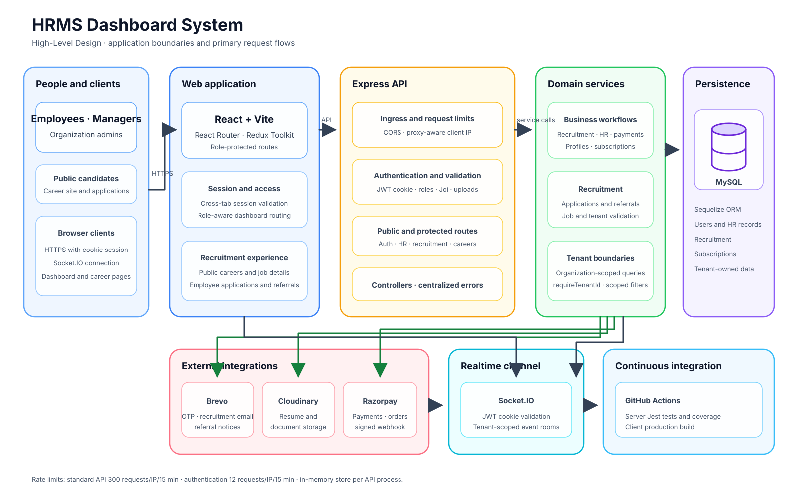

# Multi-Organization HRMS Dashboard System

HRMS Dashboard System is a full-stack Human Resource Management platform for handling employee operations, attendance, leave workflows, expenses, assets, and recruitment from a single dashboard. It is built as a monorepo with a React frontend and a Node.js + Express backend backed by MySQL through Sequelize.

The platform now supports a multi-organization architecture, allowing multiple companies to operate independently within the same application. Each organization has its own admin, users, policies, dashboards, and operational records, with tenant-aware isolation enforced across the backend, database layer, and realtime communication.

This repository is focused on practical, production-style HR workflows:

- secure authentication with OTP verification
- role-based dashboards for admin, manager, and employee users
- multi-organization onboarding with tenant-scoped data separation
- attendance monitoring and attendance policy management
- leave policy, leave balance, and leave approval workflows
- asset allocation and request handling
- expense submission and approval
- recruitment pipelines from requisition to offer, including employee applications and referrals
- role-protected dashboards with cross-tab session revalidation
- API rate limits for standard and authentication requests
- realtime request updates using Socket.IO

## Default Credentials

For testing purposes, the following default user accounts are available:

### Admin

- Email: `admin@orvane.com`
- Password: `Admin@123`

### Manager

- Email: `manager1@orvane.com`
- Password: `Manager@123`

### Employee

- Email: `employee@orvane.com`
- Password: `Employee@123`

### Organization Registration Default

When a new organization is registered through the organization onboarding flow, the current service creates the initial organization admin with the default password:

- Password: `Admin@123`

## Table of Contents

- [Project Overview](#project-overview)
- [Key Capabilities](#key-capabilities)
- [Multi-Organization Architecture](#multi-organization-architecture)
- [User Roles](#user-roles)
- [Tech Stack](#tech-stack)
- [System Architecture](#system-architecture)
- [High-Level Design](#high-level-design)
- [Folder Structure](#folder-structure)
- [Frontend Routes](#frontend-routes)
- [Backend Modules](#backend-modules)
- [API Summary](#api-summary)
- [Environment Variables](#environment-variables)
- [Local Development Setup](#local-development-setup)
- [Database Notes](#database-notes)
- [Available Scripts](#available-scripts)
- [Continuous Integration](#continuous-integration)
- [Authentication and Security](#authentication-and-security)
- [Realtime Communication](#realtime-communication)
- [Recent Project Updates](#recent-project-updates)
- [Deployment Notes](#deployment-notes)
- [Current Limitations](#current-limitations)
- [Roadmap](#roadmap)
- [Conclusion](#conclusion)

## Project Overview

The HRMS Dashboard System centralizes internal HR operations that are usually spread across spreadsheets, email chains, and disconnected tools. The application provides one place to manage workforce activity and operational HR processes.

The codebase is split into:

- `client/` for the web dashboard and public career pages
- `server/` for the REST API, business logic, realtime events, and database layer

The system currently includes modules for:

- authentication
- organization registration and onboarding
- employee and manager management
- attendance and attendance-policy administration
- leave management system
- asset request workflows
- expense workflows
- recruitment management

## Key Capabilities

### Organization Management

- register a new organization from a public onboarding flow
- create the first admin user during organization registration
- maintain organization profile and legal information
- support isolated organization-level dashboards and operations

### Authentication and Session Management

- OTP verification for account access
- login with JWT-based cookie session
- logout and current-user session check
- profile hydration after login so the header immediately shows the account name and avatar
- protected admin, manager, and employee route groups
- cross-tab session revalidation when another tab logs in or logs out

### Employee Administration

- register users and managers
- assign workers to managers
- block or unblock users
- track login IP activity
- block or unblock suspicious IPs

### Attendance Management

- store attendance data
- create and process attendance requests
- support attendance approvals and rejections
- configure organization-level attendance policies
- maintain overtime and attendance-related models

### Leave Management System

- define leave types
- define leave policies
- assign leave policies
- track leave balances
- apply for leave
- approve or reject leave requests

### Asset and Expense Workflows

- manage asset inventory
- request assets
- approve or reject asset requests
- submit expenses
- approve or reject expense entries

### Recruitment Management

- create job requisitions
- publish job postings
- manage candidate records
- receive applications
- schedule and track interviews
- collect interview feedback
- move candidates across hiring stages
- generate and accept offers
- allow employees and managers to apply to active internal and external jobs
- allow employees and managers to refer candidates to active internal and external jobs
- create candidate, application, and referral records for employee referrals and email candidates a profile-received confirmation

### Public Careers Experience

- list open jobs
- view organization-specific job details
- submit job applications
- review and accept offers through tokenized links

## Multi-Organization Architecture

The platform is now structured as a multi-tenant HRMS system.

### What This Means

- each organization is created through `/organization/register`
- the registering admin is attached to that organization as its tenant owner
- major business entities carry `tenantId` for data isolation
- tenant-aware helpers such as `requireTenantId`, `getScopedWhere`, and `assertSameTenant` are used across services
- public recruitment routes support organization-aware career pages using organization slug-based URLs
- employee applications and referrals are scoped to the employee's tenant, require an active job with remaining headcount, and start at its default hiring stage
- Socket.IO rooms are tenant-aware for admin, manager, and user notifications

### Tenant-Aware Modules

The current backend structure shows organization-aware relationships across:

- users and managers
- attendance and attendance policies
- leave requests, leave balances, leave types, and leave policies
- assets and asset requests
- expenses
- recruitment entities such as job postings, candidates, interviews, offers, and applications

This design allows the same application instance to support multiple organizations without mixing HR, leave, attendance, asset, expense, or recruitment records across tenants.

## User Roles

### Admin

Admins have the highest level of operational control in the system for their own organization. They can manage users, managers, attendance policies, leave settings, IP restrictions, requests, expenses, assets, and recruitment workflows.

### Manager

Managers can supervise team-level operations including users assigned to them, attendance review, leave request decisions, asset requests, expenses, and recruitment-related responsibilities.

### Employee

Employees can access their own attendance, leave, assets, expenses, profile, and internal recruitment pages. Frontend route guards recognize the `employee` role and the legacy `user` role value.

### Candidate

Candidates interact with the public-facing careers and offer pages without needing access to the internal dashboard.

## Tech Stack

### Frontend

- React 19
- Vite
- Material UI
- Redux Toolkit
- Redux Persist
- React Router
- Axios
- Socket.IO Client
- Tailwind CSS
- Day.js

### Backend

- Node.js
- Express
- Sequelize ORM
- MySQL
- Joi validation
- JWT
- Cookie Parser
- CORS
- Socket.IO
- Nodemailer
- Brevo API integration
- Cloudinary

## System Architecture

The backend follows a modular layered architecture.

```text
Client UI
  -> Route components
  -> Frontend service layer
  -> REST API / Socket.IO
  -> Express routes
  -> Controllers
  -> Services
  -> Sequelize models
  -> MySQL database
```

### Backend Layer Responsibilities

- `routes/` define API endpoints and mount domain modules
- `controllers/` receive requests and shape responses
- `services/` contain business logic
- `models/` define entities and relationships
- `middlewares/` handle auth, validation, and error flow
- `utils/` provide helpers for tenant scoping, JWT, mail templates, geo lookup, PDF generation, socket room generation, and response formatting

### Architectural Highlights

- clear separation of concerns
- role-based routing and middleware
- modular domain organization
- reusable service layer
- multi-organization tenant isolation
- realtime event delivery with Socket.IO

## Folder Structure

```text
HRMS_Dashboard_System/
|-- docs/
|   \-- HLD.svg
|-- client/
|   |-- public/
|   |-- src/
|   |   |-- assets/
|   |   |-- components/
|   |   |   \-- routing/ProtectedRoute.jsx
|   |   |-- pages/
|   |   |   |-- AdminPages/
|   |   |   |-- Auth/
|   |   |   |-- CareerPages/
|   |   |   |-- ManagerPages/
|   |   |   |-- UserPages/
|   |   |   \-- organization/
|   |   |-- redux/
|   |   |-- services/
|   |   |-- store/
|   |   |-- App.jsx
|   |   |-- main.jsx
|   |   \-- socket.js
|   |-- package.json
|   \-- vite.config.js
|-- server/
|   |-- src/
|   |   |-- config/
|   |   |-- constants/
|   |   |-- controllers/
|   |   |   |-- admin/
|   |   |   |-- attendance/
|   |   |   |-- LMS/
|   |   |   |-- manager/
|   |   |   |-- organization/
|   |   |   |-- recruitment/
|   |   |   \-- user/
|   |   |-- middlewares/
|   |   |-- models/
|   |   |   |-- AssetModels/
|   |   |   |-- AttendanceModels/
|   |   |   |-- LeaveModels/
|   |   |   |-- Organizations/
|   |   |   |-- RecruitmentModels/
|   |   |   \-- UserModels/
|   |   |-- routes/
|   |   |-- services/
|   |   |-- utils/
|   |   |-- validators/
|   |   |-- app.js
|   |   \-- server.js
|   \-- package.json
\-- README.md
```

### Important Frontend Areas

- `client/src/pages/Auth/` authentication pages
- `client/src/pages/AdminPages/` admin dashboard modules
- `client/src/pages/ManagerPages/` manager dashboard modules
- `client/src/pages/UserPages/` employee dashboard modules
- `client/src/pages/CareerPages/` public recruitment pages
- `client/src/pages/organization/` organization onboarding flow
- `client/src/services/` API integrations grouped by domain

### Important Backend Areas

- `server/src/config/` environment, database, OTP, and cloud configuration
- `server/src/routes/` API route groups
- `server/src/controllers/` HTTP request handlers
- `server/src/services/` domain logic
- `server/src/models/` Sequelize schema definitions
- `server/src/middlewares/` auth and validation middleware
- `server/src/utils/tenant.utils.js` tenant-scoping utilities

## High-Level Design

The production-style system diagram covers the browser, role-aware frontend routes, Express API middleware, tenant-scoped services, MySQL, external providers, realtime traffic, and CI.



See [docs/HLD.svg](docs/HLD.svg) for the full-size architecture diagram.

## Frontend Routes

The frontend uses React Router and currently exposes major screens such as:

### Public Routes

- `/`
- `/login`
- `/forgot`
- `/organization/register`
- `/careers`
- `/careers/:orgSlug/:slug`
- `/careers/:orgSlug/:slug/apply`
- `/offer/:token`

### User Dashboard

- `/user/dashboard`
- `/user/asset`
- `/user/expense`
- `/user/attendance`
- `/user/leave-management`
- `/user/profile`
- `/user/job-posts`

### Admin Dashboard

- `/admin/dashboard`
- `/admin/ips`
- `/admin/requests`
- `/admin/asset`
- `/admin/expenses`
- `/admin/manager`
- `/admin/attendance-policy`
- `/admin/attendance`
- `/admin/leave-requests`
- `/admin/leave-policy`
- `/admin/leave-type`
- `/admin/job-requisition`
- `/admin/job-posts`
- `/admin/job-applications`

### Manager Dashboard

- `/manager/dashboard`
- `/manager/assets`
- `/manager/users`
- `/manager/requests`
- `/manager/attendance/request`
- `/manager/attendance/me`
- `/manager/expenses`
- `/manager/leave-requests`
- `/manager/job-posts`
- `/manager/job-requisition`
- `/manager/leave/management`
- `/manager/interviews`
- `/manager/profile`

Protected dashboard routes redirect signed-out users to `/login`. Authenticated users who open a route for another role are redirected to their own dashboard.

## Backend Modules

Major backend route groups mounted in `server/src/app.js`:

- `/auth`
- `/users`
- `/admin`
- `/manager`
- `/account`
- `/attendance`
- `/attendance-policy`
- `/lms`
- `/recruitment`
- `/payment`
- `/subscription`
- `/organization`
- `/department`

### Module Breakdown

#### Auth Module

Handles login, OTP verification, logout, session inspection, access-token refresh, and password recovery. Login, OTP, and recovery endpoints use a stricter rate limit.

#### User Module

Handles authenticated user operations such as assets, expenses, attendance, leave access, and user information.

#### Admin Module

Handles organization-wide management flows including users, managers, assets, attendance, expenses, leave requests, and recruitment management for the current tenant.

#### Manager Module

Handles team-level workflows such as employee oversight, requests, expenses, attendance, leave actions, and selected recruitment workflows.

#### LMS Module

Handles leave balances, leave types, leave policies, and leave-related workflows.

#### Recruitment Module

Handles requisitions, job postings, applications, candidates, interviews, interview feedback, stage progression, offers, and referrals. Employee/manager apply and referral endpoints support both internal and external visibility, create records in the standard hiring pipeline, and validate active status, expiration, tenant, and headcount.

#### Request Protection

Applies a shared standard request budget to API traffic and a separate stricter budget to authentication and account-recovery endpoints. The payment webhook is excluded from the standard browser request limit.

#### Organization Module

Handles public organization registration and onboarding.

#### Department Module

Handles department CRUD and department-level organization structure management.

## API Summary

This section is intentionally high-level so a visitor can understand the shape of the system quickly.

### Authentication Endpoints

Base path: `/auth`

- `POST /auth/login`
- `POST /auth/verify`
- `POST /auth/logout`
- `GET /auth/me`
- `POST /auth/access_token`
- `POST /auth/forgot_password`
- `POST /auth/reset_password`
- `POST /auth/resend_otp`

### Organization Endpoints

Base path: `/organization`

- `POST /organization/register`

### Attendance Policy Endpoints

Base path: `/attendance-policy`

- `POST /attendance-policy/`
- `GET /attendance-policy/`
- `GET /attendance-policy/all`
- `PUT /attendance-policy/:id`
- `DELETE /attendance-policy/:id`

### User-Facing Examples

Base path: `/users`

- attendance data
- expense submission and updates
- asset visibility
- leave application and leave balance lookup

### Admin-Facing Examples

Base path: `/admin`

- user registration and listing
- manager registration and assignment
- IP blocking and unblocking
- asset CRUD
- request approvals
- expense approvals
- attendance approvals
- leave request decisions

### Manager-Facing Examples

Base path: `/manager`

- team user management
- asset request review
- expense review
- attendance review
- leave request approval or rejection

### Recruitment Examples

Base path: `/recruitment`

- requisition creation and approval
- job post creation and publishing
- public jobs listing
- application submission
- interview scheduling
- interview feedback
- offer generation
- offer acceptance

Employee and manager job-post actions:

- `GET /recruitment/internal/jobs`
- `GET /recruitment/internal/jobs/:slug`
- `POST /recruitment/internal/jobs/apply/:slug` (multipart form with a `resume`)
- `POST /recruitment/internal/jobs/referral/:slug` (candidate details and a `resume`)

These authenticated actions accept active internal or external postings. Public candidate applications use `POST /recruitment/application/apply/:orgSlug/:slug`.

### Department Examples

Base path: `/department`

- create department
- update department
- list departments for the current tenant
- remove department

## Environment Variables

### Server `.env`

The backend reads the following environment variables from `server/src/config/env.js`:

```env
PORT=5000
SECRET=your_app_secret
DB_HOST=localhost
DB_PORT=3306
DB_USER=root
DB_PASSWORD=your_password
DB_NAME=hrms_dashboard
JWT_PASSWORD=your_jwt_secret
MAIL_USER=your_email
MAIL_PASS=your_email_password
GEO_API_KEY=your_geo_api_key
CLOUD_NAME=your_cloudinary_name
CLOUD_KEY=your_cloudinary_key
CLOUD_SECRET=your_cloudinary_secret
CLIENT_URL=http://localhost:5173
BREVO_API_KEY=your_brevo_api_key
OFFER_URL=http://localhost:5173/offer
DOMAIN_URL=http://localhost:5173
```

### Client `.env`

The frontend expects:

```env
VITE_BASE_URL=http://localhost:5000
```

## Local Development Setup

### Prerequisites

- Node.js 18 or later
- npm 9 or later
- MySQL database instance

### Install Frontend Dependencies

```bash
cd client
npm install
```

### Install Backend Dependencies

```bash
cd server
npm install
```

### Run Backend

```bash
cd server
npm run dev
```

### Run Frontend

In a separate terminal:

```bash
cd client
npm run dev
```

### Multi-Organization Flow to Test

1. Start the backend and frontend locally.
2. Open `/organization/register` to create a new organization.
3. Use the generated admin account to log in.
4. Create managers and employees under that organization.
5. Verify that attendance, leave, expenses, assets, and recruitment data stay isolated to that organization.

## Database Notes

- the Sequelize config in `server/src/config/db.js` currently enforces SSL (`dialectOptions.ssl.require=true`)
- for some local MySQL instances, SSL may need to be enabled in MySQL or adjusted in backend config for local-only development
- table sync (`sequelize.sync`) is present but not enabled by default in `server/src/server.js`

## Available Scripts

### Client

From `client/package.json`:

```bash
npm run dev
npm run build
npm run lint
npm run preview
```

### Server

From `server/package.json`:

```bash
npm run dev
npm start
npm test
npm test -- --coverage
```

## Continuous Integration

The GitHub Actions workflow in `.github/workflows/ci.yml` runs on pushes and pull requests to `main`. It installs dependencies with `npm ci`, runs the server Jest suite with coverage thresholds, and builds the client using Node.js 22.

Coverage reports are generated under `server/coverage/` and are git-ignored. Jest enforces per-file coverage thresholds for the tested recruitment, rate-limiting, validation, and tenant-scope modules.

## Authentication and Security

The project currently uses several security-related controls:

- JWT-based authentication
- HTTP-only cookie session storage
- role-based access middleware
- client-side protected route groups for admin, manager, and employee roles
- server-side request rate limiting: 300 requests per IP per 15 minutes for standard API traffic and 12 requests per IP per 15 minutes for authentication and recovery attempts
- cross-tab session revalidation after login/logout and when a protected tab regains focus
- OTP verification for critical auth flows
- IP logging on login
- IP and user blocking capabilities
- cookie-based auth propagation into Socket.IO connections
- tenant-aware access validation in service logic

### Security Notes

- frontend requests are sent with `withCredentials: true`
- cookies are configured with `httpOnly`
- cross-origin requests are enabled for trusted frontend origins
- production deployments should run over HTTPS
- tenant-aware service checks help prevent cross-organization access
- the standard API rate limiter skips the payment webhook; authentication routes have a separate, stricter limit
- the rate limiter currently uses an in-memory store per Node.js process; multiple API replicas require a shared store to enforce a common quota

## Realtime Communication

Socket.IO is initialized on the backend in `server/src/server.js` and on the frontend in `client/src/socket.js`.

Current realtime usage includes:

- room-based subscriptions for admins
- room-based subscriptions for managers
- user-specific socket rooms
- tenant-aware event isolation
- request update broadcasting

Supported events in the current implementation include:

- `requestCreated`
- `requestUpdated`

## Recent Project Updates

- added payment module endpoints under `/payment` (including webhook handling)
- added subscription module endpoints under `/subscription`
- expanded recruitment tracking with `Referral` and `InterviewAuditLog` entities
- completed employee job application and referral flows for internal and external postings, including candidate profile creation, hiring-stage assignment, referral attribution, and candidate email confirmation
- added centralized role-based frontend route protection and cross-tab session refresh
- added standard and auth-specific API rate limiting
- added recruitment, validation, tenant utility, and rate-limit tests with CI coverage thresholds
- replaced the recruitment-only ER text with the project HLD at [`docs/HLD.svg`](docs/HLD.svg)
- continued tenant-aware modeling with `tenantId` on latest recruitment entities
- maintained organization-scoped realtime and API access patterns across new modules

## Deployment Notes

- the frontend contains `client/vercel.json`, which indicates Vercel deployment support for the UI
- set `CLIENT_URL` to the deployed frontend origin
- set `VITE_BASE_URL` to the deployed backend base URL
- use HTTPS in production because cookies are secure in real deployments
- ensure MySQL and any mail/cloud integrations are configured in the deployment environment
- verify tenant-aware environment configuration when deploying as a shared multi-organization system

## Current Limitations

- no root license is defined yet
- no `.env.example` files are included yet
- API request and response examples are not documented yet
- setup instructions do not yet include seed/demo data for multiple organizations
- organization onboarding documentation can be expanded further with payload examples
- the in-memory request limiter does not share quotas between multiple backend instances

## Roadmap

- add `.env.example` files
- add Postman or OpenAPI documentation
- add screenshots of admin, manager, and user dashboards
- add screenshots for the organization registration flow
- add seed scripts for demo users, policies, and organizations
- expand automated tests to remaining legacy HR services and auth workflows
- add a shared rate-limit store before horizontally scaling the backend
- add deployment guides for frontend and backend
- expand documentation around tenant lifecycle and organization administration

## Conclusion

This project represents a practical, multi-organization HRMS Dashboard System with clear module separation, role-based workflows, and a broad operational scope. It is suitable as a major project, portfolio project, or foundation for a more production-ready SaaS-style HR platform.
